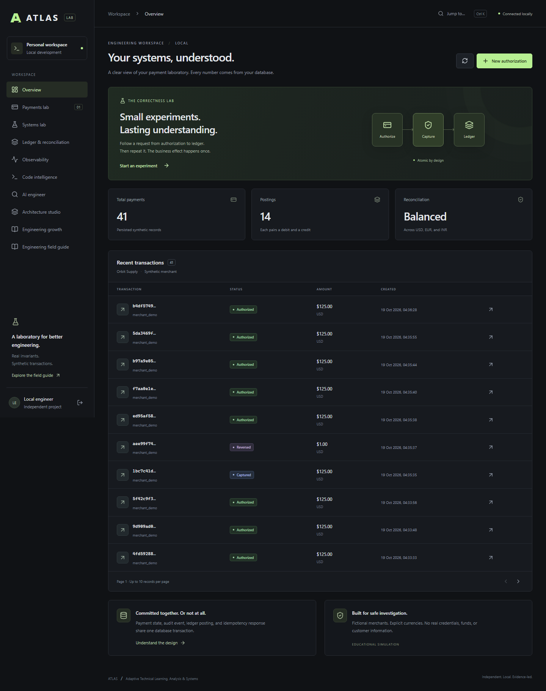

# ATLAS

[](https://github.com/EklavyaGoyal17/ATLAS/actions/workflows/ci.yml)

**Adaptive Technical Learning, Analysis & Systems**
Understand systems. Build confidently. Investigate intelligently. Engineer reliably.

An independent, local engineering laboratory. All payments, merchants, and ledger accounts are synthetic. No affiliation with or endorsement by American Express. Never enter real payment credentials, customer data, company code, or confidential logs.

## Start here

Prerequisites: Docker Desktop with Linux containers and a normal Git checkout for source import. Native development/full verification also requires Java 21+ (build targets Java 21), Maven 3.9+, Node 24 LTS and Git on PATH.

```powershell
Copy-Item .env.example .env
docker compose up --build -d --wait
```

Open <http://localhost:5173>. Enter the local bearer token from `.env`. The deliberately public development token in `.env.example` is only for a loopback-bound local installation. Change it before sharing your machine. The API refuses to start with an empty or short token. PostgreSQL persists in a named Docker volume.

Docker Compose now builds and runs successfully on the implementation host. PostgreSQL's host port defaults to **5434** (`ATLAS_DB_PORT`); container-to-container connections still use 5432. The separate test database uses 5433. No existing database service is stopped or reconfigured.

### Windows fallback when Docker is unavailable

If Docker is unavailable, this verified alternative downloads checksum-pinned PostgreSQL 17.11 binaries from Maven Central (Zonky's testing distribution), stores everything under ignored `.runtime`, and starts it on loopback port 5433. It requires Windows x64, Java 21+ and `tar` on PATH. It does not install a system service or change an existing PostgreSQL instance.

```powershell
powershell -NoProfile -File scripts/local-postgres.ps1 start
$env:ATLAS_DB_URL='jdbc:postgresql://localhost:5433/atlas'
$env:ATLAS_API_TOKEN='atlas-local-development-token-change-me'
mvn -B -f backend/pom.xml spring-boot:run
```

In another terminal: `cd frontend`, `npm ci`, `npm run dev`. Open <http://127.0.0.1:5173> and use the token above. Stop only this local database with `powershell -NoProfile -File scripts/local-postgres.ps1 stop`; data remains for the next start. The same fallback creates the separate `atlas_test` database used by Maven tests, so do not also start the Compose test database on port 5433. The fallback is a reduced testing distribution without `pg_dump`; use matching PostgreSQL client tools for backups. For ongoing use, keep live database storage outside cloud-synchronized folders.

For native Java/React development against Docker's PostgreSQL service, run these from the repository root, in separate terminals:

```powershell
docker compose up -d db
$env:ATLAS_DB_URL='jdbc:postgresql://localhost:5434/atlas'
$env:ATLAS_API_TOKEN='atlas-local-development-token-change-me'
mvn -B -f backend/pom.xml spring-boot:run
```

```powershell
cd frontend
npm ci
npm run dev
```

Create an authorization for `12500` USD minor units ($125.00), inspect its timeline, replay the request, capture it, then refund `2500`. Open Ledger to reconcile the result. The UI accepts **integer minor units**, never card details. USD, EUR, and INR use two fractional digits here. Authorization above 50,000,000 minor units is declined by a deterministic educational rule.

## Scope and evidence

The console now connects all seven module areas: correct synthetic payment workflows; a durable outbox worker and twelve deterministic systems models; measured OpenTelemetry traces and eight controlled incident recipes; approved read-only repository import with Java AST navigation, declared dependency maps and source-supported potential calls; a cited local-evidence assistant with an opt-in provider interface; editable versioned architecture diagrams; and persistent engineering journals, ADRs, learning evidence and rubric reviews. Signed loopback webhooks demonstrate duplicate HTTP deliveries. No external webhook destinations or financial networks are contacted.

Verification evidence and exact test counts are recorded in [TESTING](docs/TESTING.md). The checks include **127 backend cases on Java 21** and **34 real-container browser checks across Chromium and Firefox**, frontend builds, dependency audits, runtime-image scans, API restart recovery and an isolated logical restore drill. Code intelligence offers source-linked dependency-cycle groups, distinct-type coupling counts, selected-file change-impact paths and snapshot-bound exports over a conservative Java subset. New investigations preserve bounded baseline/affected span evidence across restarts; real isolated PostgreSQL pool recovery is also exercised. The local assistant offers cited static facts and proposed investigation/test steps. The repository is published and its hosted verification/source-vulnerability jobs have passed; the badge links to the current branch result. No live AI model has been used and no repository content has been sent to an AI provider. [AI and import](docs/AI_AND_IMPORT.md) explains privacy, consent, supported analysis and optional bridge configuration.

Implemented source boundaries: `payments` (workflow/ledger), `eventing` (durable delivery, signed local webhooks and isolated models), `observability` (OTel and durable bounded investigations), `intelligence` (safe import, AST, architecture/impact review, retrieval and optional explanations), `workspace` (versioned records), `platform` (authentication, rate budgets and errors), and `frontend/src` (console). SQL and transaction boundaries are explicit. Twelve ADRs explain JDBC, the SVG editor, telemetry, durable incident evidence, conservative architecture/impact analysis and privacy decisions.

`backend/.../eventing` owns outbox delivery, consumer receipts, worker control and experiments. The notification sink is entirely local. Ticks are simulation units; crash injection omits a commit/ack boundary and does not terminate the JVM. The separate restart script restarts the real API container to verify durable recovery.



## Verification

For a complete Windows check using the public `.env.example` local configuration:

```powershell
powershell -NoProfile -File scripts/verify.ps1
```

This builds/tests both apps, runs the actual Compose stack, exercises browser workflows, audits frontend dependencies, and restarts the API to verify recovery. It preserves application data and uses only the guarded disposable `atlas_test` database for destructive test fixtures. It requires Docker, Maven, Java 21+, Node 24+, and network access for missing dependencies. Runtime-image vulnerability scanning is recorded separately in TESTING.

Integration tests require a **dedicated, disposable PostgreSQL database**:

```powershell
docker compose --profile test up -d --wait test-db
$env:ATLAS_TEST_DB_URL='jdbc:postgresql://localhost:5433/atlas_test'
mvn -B -f backend/pom.xml verify
cd frontend
npm ci
npm run build
npx playwright install chromium
npm run test:e2e
```

Playwright expects the API on port 8080 with the development token (override `ATLAS_E2E_TOKEN` if needed), and normally starts/reuses Vite itself. For the Compose console, set `$env:ATLAS_E2E_EXTERNAL='true'` before running Playwright. Tests write real synthetic records and pause the synthetic worker before scenarios. Backend tests truncate **only their dedicated local atlas_test database**. See [API](docs/openapi.yaml), [demo](docs/DEMO.md), [security](docs/SECURITY.md), and [learning notes](docs/WHAT_I_LEARNED.md).

Stop without deleting data: `docker compose down`. Deleting the named volume is a separate destructive action; no reset script runs automatically. Architecture diagrams export as SVG/JSON; engineering records export as JSON/Markdown. These exports are not full database backups. The [isolated restore drill](docs/RECOVERY.md) verifies `pg_dump`/`pg_restore` of generated synthetic fixtures, including ledger state, delivery receipts, journal revisions, constraints and sequences, without touching application data. Actual application backups and restoration remain operator-controlled; `.dump` files are excluded from Git.
