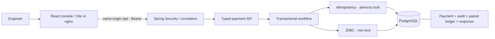

# Architecture and discovery

The initial workspace was empty: there was no existing code to retain. The host provides Maven 3.9.16, Java 25, Node 24, and Docker Desktop. Source targets Java 21. Dependencies are pinned; Spring Boot 4.1.1 supports this toolchain. This is a local single-user application, not a shared financial service.

## Initial journeys

1. Launch, authenticate with the configured local token, create a synthetic authorization.
2. Repeat the exact request and observe the original payment and a replay indicator.
3. Capture once, refund partially, inspect immutable timeline and balanced postings.
4. Attempt an invalid transition; receive a conflict with no partial business effects.
5. Restart the API and inspect the same persisted payment.

## Trust and transaction boundaries

Only configured bearer tokens can reach `/api`. There are no cookies or CORS grants. Health returns minimal public readiness. The console never persists its token. All user strings render as React text. Approved repository reads use bounded allowlisted paths; Git inspection uses fixed read-only builtins without a shell. Optional model adapters have no mutation or execution tools and require per-request source-transmission approval. The separate developer recovery-check script deliberately invokes Docker to restart this project's API.

Repository metadata captures one immutable approved snapshot and returns its identity. The console requests that identity, hides old inventory during replacement/deletion, and withholds mismatches. Extension counts and redacted UTF-8 text sizes describe the indexed subset. Bounded manifest declarations do not run package managers or resolve environments. [ADR 014](DECISIONS/014-snapshot-bound-repository-inventory.md) describes supported Python/Go syntax, declaration evidence, output budgets and the Java-only structured-analysis limit. Source masking scans maximal identifiers rather than repeatedly backtracking over long tokens; known-token masking preserves source line separators, and private-key beginnings withhold the file even if truncated.

The controller validates trust-boundary inputs. `PaymentService` owns one database transaction per command; `PaymentStore` maps SQL rows to immutable records. JDBC is chosen over JPA to expose PostgreSQL locking and SQL clearly in this teaching slice. Domain status checks precede writes. Migration constraints defend amount ranges and row invariants. Paired postings make an unbalanced single-sided journal entry unrepresentable through the application.

Commands lock the idempotency key first, then the payment row, in consistent order. Equal merchant/key requests serialize across app processes using a transaction-scoped advisory lock. A stored fingerprint detects changed payloads; the original response is retained permanently in this version. A conflicting key returns 409. Failures roll back all effects and do not reserve the key. HTTP response loss after commit can be recovered by retrying the original key. Captures with different keys serialize on `SELECT FOR UPDATE`; only the first observes AUTHORIZED. Refunds with different keys cannot collectively exceed captured funds.

Read workflows use a repeatable-read transaction so payment, audit, and ledger describe one database snapshot. History is bounded offset pagination with a deterministic secondary sort. Large histories should migrate to cursor pagination. Connection pool: 10, connection acquisition timeout: 5 seconds. PostgreSQL startup options bound statements to 10 seconds and lock waits to 5 seconds. The authenticated JSON reader caps fixed-length and chunked request bodies at 16 KiB.

## Domain model

`merchant_demo` is the sole supported merchant. Payment states: AUTHORIZED, DECLINED, CAPTURED, REFUNDED, REVERSED. CAPTURED includes partial refunds, tracked separately. Full capture only. Reversal only releases an uncaptured authorization. No authorization expiry, settlement, fees, FX, network routing, or actual funds movement.

Capture debits acquirer receivable and credits merchant payable. Refund reverses those accounts. USD/EUR/INR are reconciled separately; cross-currency totals are never added together. Reconciliation checks both debit-credit balance and payment-to-posting amounts/currency, because balanced books can still contain missing or wrong business records. It detects inconsistency but never silently repairs it.

## Deliberate boundaries

HTTP telemetry keeps fixed operation labels and bounded independent windows, with separate lifetime counters. The incident copilot calculates a bounded brief from saved measurements and trace/span identities, without provider transport or journal retrieval. Review evidence uses exact public references and explicit self-reporting rather than automated correctness grading. ADR validation occurs before database mutation while preserving legacy reads. [ADR 017](DECISIONS/017-explicit-evidence-and-measurement-cohorts.md) records the four prompt-audit completions and measured-cohort limits.

`RepositoryIndex` publishes snapshot, approved local root and revision as one immutable atomic state. Local imports use one worker with no queue and a twelve-second processing budget covering draft construction and waiting for the approval audit. Only the waiting request can publish through a final compare-and-set; timeout, interruption, deletion and competing publication prevent abandoned work from replacing state. Cancellation retains admission until actual worker exit, so an operation that ignores interruption can keep later local imports busy. Reads do not wait on filesystem/audit work. Approval audit events record attempts rather than guaranteed publication; deletion invalidates state before its own database audit. [ADR 016](DECISIONS/016-local-import-deadlines-and-publication.md) records races, status codes and termination limits.

`GitHubRepositoryImport` is a public-source adapter, separate from approved local-root reads and optional model transport. Anonymous bounded requests pin the default branch commit and validate the one archive redirect. ZIP text is filtered in memory and published through the same index/redaction/parser pipeline. Snapshot origin identifies local versus GitHub sources, and revision checks prevent an in-flight download resurrecting a deleted/replaced import. No filesystem checkout or imported process is created. Non-Java supported formats remain source text; [ADR 013](DECISIONS/013-approved-public-github-snapshots.md) records limits and privacy.

`RepositoryImpact` walks incoming references from all resolved types in selected indexed files. Iterative multi-source breadth-first search returns one deterministic shortest source-evidence path per dependent type. It reuses the qualified architecture graph and concurrency gate; exact snapshot IDs and path membership are checked before analysis. The browser invalidates results on selection/import changes. Counts, unrepresented files and bounded paths remain explicit. [ADR 012](DECISIONS/012-source-linked-change-impact.md) explains the distinction between declaration reachability and runtime impact or test coverage.

`RepositoryArchitecture` reads one approved redacted snapshot and returns qualified Java declaration references, strongly connected groups and distinct-type coupling counts. Unsupported resolution is skipped, findings carry source lines and snapshot identity, and count/concurrency budgets bound the analysis. It executes no source, classpath discovery, installation or model call. The console offers source navigation and bounded JSON export; [ADR 011](DECISIONS/011-conservative-architecture-review.md) records semantics and limits.

Controlled investigations use independent sample traces and save their bounded evidence atomically with their document. `IncidentArchive` stores at most 128 spans/128000 UTF-8 bytes per investigation in the V5 table; deleting the document cascades to its evidence. Live telemetry remains in memory. The console separates live spans from saved evidence and can reopen/filter/export an investigation after restart. Old records explicitly lack archived spans. [ADR 010](DECISIONS/010-durable-incident-evidence.md) explains retention and transaction boundaries.

No microservices, external broker, Redis, vector database or Kubernetes is needed for the local experiments. OpenTelemetry SDK records real HTTP/JDBC timings in a bounded local exporter, including W3C context across signed loopback webhook calls. Structured logs expose the same correlation IDs. Controlled dependency delays and logical model events are explicitly synthetic. The optional provider interface defaults to local source retrieval and performs no model call without configuration and per-request approval.

The frontend uses native HTML dialogs and controls, a small CSS token system, and Lucide icons rather than a UI component framework/Tailwind. Dialogs provide browser focus confinement and Escape handling. The bounded native SVG editor supports pointer/keyboard movement and export; source maps show parser evidence. It replaces React Flow for the deliberately small graph. Incident distributions use measured sample cards and span-duration bars. Integration tests use explicitly provisioned PostgreSQL rather than Testcontainers so the same suite runs against the Windows fallback, a CI service container and the Java 21 Docker test runner.

Dependency baseline was checked against [Spring Boot's runtime requirements](https://docs.spring.io/spring-boot/system-requirements.html), [Vite's guide](https://vite.dev/guide/), and the registry at implementation time. Versions are pinned in pom.xml/package-lock.json. This does not replace continued vulnerability checks.

## Asynchronous delivery boundary

`eventing.OutboxPublisher` requires an existing transaction. Payment events now persist immutable, versioned envelopes with their audit IDs in the same transaction as the original command. `DeliveryService` uses explicit independent transaction templates for claim, consumer commit and acknowledgement; this makes the interruption windows visible. A scheduler processes one event per poll when enabled in the persisted worker control. The inbox and local notification archive are an idempotent consumer boundary. They never modify payment or ledger state.

The default worker is paused. Logical ticks drive deterministic retry and lease expiry. The same code executes manual steps and background polls. `ExperimentService` prepares a new authorization and fault atomically under a paused control lock, with request-key replay. All controls require the existing local engineer bearer token. [ADR 006](DECISIONS/006-durable-delivery-and-logical-clock.md) and [DELIVERY](DELIVERY.md) explain ordering, fencing, restart behavior and limits.

Compose is now verified locally. Database host port defaults to configurable 5434 because 5432 was unavailable on this Windows host. Container-to-container PostgreSQL remains on 5432. The API health check gates console startup. nginx re-resolves the API service address so container replacement does not permanently cache its old IP. The Docker path runs Java 21; the native host runs Java 25 targeting Java 21 bytecode.
