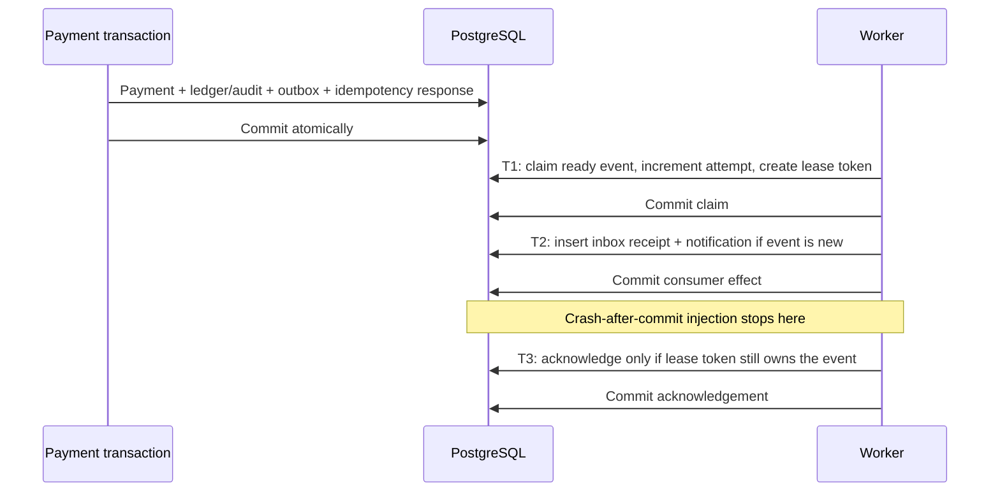

# Durable delivery laboratory

The Systems Lab demonstrates real PostgreSQL persistence and a real scheduled background consumer. Every delivery targets a **local synthetic notification archive**. It does not send webhooks or use an external broker.

## Start and inspect

```powershell
docker compose --env-file .env.example up --build -d
```

Open http://127.0.0.1:5173, connect using the public local token in `.env.example`, and choose **Systems lab**. The worker is initially paused. A saved running setting survives an application restart; pause it before preparing or stepping experiments.

**Crash after commit**:

1. Select **Prepare crash after commit**. This atomically creates a new 12500 USD synthetic authorization, audit event, outbox envelope and fault configuration.
2. Select **Step selected event**. Observe PROCESSING, one committed effect, and a missing acknowledgement. The timeline shows CLAIMED → EFFECT_COMMITTED → CRASH_AFTER_COMMIT.
3. Select **2 ticks · lease recovery** and step again. Observe LEASE_EXPIRED → CLAIMED → DUPLICATE_SUPPRESSED → ACKNOWLEDGED. State becomes DELIVERED; committed effects stay at one.
4. Select **Redeliver event**, then step again. The same inbox receipt suppresses a second notification. The original envelope is unchanged.
5. Select **Inspect payment**. The authorization remains AUTHORIZED with no ledger movement. Notification delivery does not capture funds or alter the ledger.

**Crash before commit** rolls back inbox and notification, leaving zero effects and an abandoned lease. Reclaim after two ticks and observe the first effect commit.

**Retry exhaustion** fails each consumer attempt. Step once, once again, and then advance two ticks. Retry delays are 1 then 2 ticks; the third failure becomes DEAD. Inspect the timeline, explicitly redeliver (which clears the injected fault), and step to recover. Attempts reset per delivery cycle; inbox and all timeline records remain.

**Normal delivery** commits one effect and acknowledges it in the following transaction. Redelivery demonstrates deduplication without an injected crash.

## The three transactions



Claims use row locks and `SKIP LOCKED`. A lease expires after two shared logical ticks. New claims replace the token; stale workers cannot apply effects, acknowledge, or schedule a retry. Inbox and notification inserts share a transaction, with unique event IDs. An expired lease does not undo a committed notification: recovery checks the inbox first.

## A real API/JVM restart

With this checkout's Compose app running, execute:

```powershell
$env:ATLAS_API_TOKEN='atlas-local-development-token-change-me'
node scripts/recovery-check.mjs
```

The script pauses delivery, prepares a fresh post-commit interruption, proves one effect exists, restarts **only this project's API container**, waits for health, and reclaims the unacknowledged event. It asserts DELIVERED, one effect, one suppressed duplicate, and an unchanged authorization. It deletes no data. This is an actual JVM/container restart combined with a defined injected interruption, not a machine power-loss test.

## Limits and interpretation

- Ticks are simulation units, not elapsed seconds. Each enabled scheduler poll advances one tick and claims at most one event. Multiple app instances share/advance the same clock. Clock/control locking intentionally limits parallel claim throughput.
- Run/Pause is durable. Pausing stops new automatic claims; it does not cancel a consumer transaction already in flight.
- Delivery may be out of order. The sink archives immutable events instead of projecting the latest payment state.
- The event timeline displays its latest 100 records. Storage retention, queue capacity limits and large-data performance remain future work.
- An IDLE step can reclaim and dead-letter an abandoned third lease without starting a new consumer attempt; the event detail/timeline is the source of truth.
- Old V1 audit events are retained but are not backfilled with invented historical snapshots. Only new payment events have outbox envelopes.
- Manual step/redelivery controls are not request-idempotent; inspect current state after a lost response. The payment commands and experiment preparation have explicit idempotency keys.
- This implementation does not prove exactly-once network delivery, external side-effect atomicity, broker failover, sagas or multi-region behavior. Those require different boundaries and experiments.
